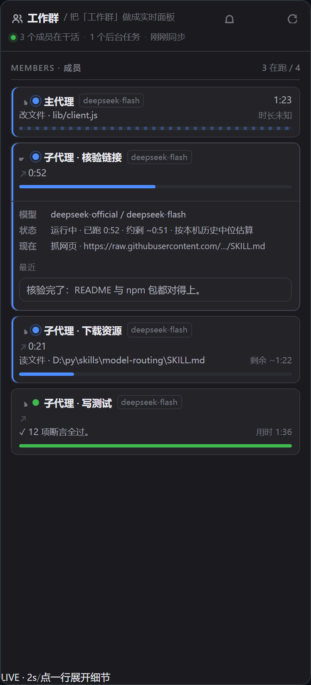

# dsh-group-tab — Workgroup

A right-sidebar tab for [DeepSeek Harness](https://github.com/deepseek-ai/deepseek-harness) (DSH) that shows **who is working right now, what each agent is doing, and how long the rest will probably take** — as a live group chat, not a static log.



Registered as a tab of [dsh-better-sidebar](https://github.com/omdsh-dev/DSH-better-sidebar) (the sidebar plugin that exposes the tab registry other plugins register into).

## Why

When a main agent delegates to three subagents and starts two background jobs, DSH's conversation view tells you about one of them. You end up opening four sessions to answer "is anything stuck?".

This tab answers it in one place:

- one card per member (main agent + every subagent in the tree), with the tool it is running right now
- a per-member ETA, from **this machine's own** finished runs (median of the last 20), clearly labelled when no history exists yet
- background jobs folded onto the member that owns them
- a merged timeline: started / tool switch / message / job progress / finished — newest at the bottom
- the model each member is dispatching on (`provider / model`)
- members waiting on **you** (a question or an approval) are pinned to the top with a red badge, a header count, and an optional chime when a subagent finishes

## Install

```sh
dsh plugin --profile web add dsh-better-sidebar   # peer: the tab host
dsh plugin --profile web add dsh-group-tab
```

Then open the right sidebar and pick **Workgroup** from the `＋` menu (it sits next to Tasks). It opens itself once per page load for the active session, and once per session as soon as delegated work starts; close it and it stops doing that for the rest of the page.

## How it reads data

| Source | Transport | What it gives |
| --- | --- | --- |
| `sessions` client service | subscription (event-driven) | who exists, who is running, titles, lineage |
| `jobs` client service | subscription (event-driven) | background task rosters per session |
| `POST /sidebar/api/subagents.live` | poll, **only while something runs** | current tool + latest text per member |
| `POST /sidebar/api/git.models` | one call per member, 30 s cache | the model route a member is using |

**Idle costs nothing.** The 2 s fold poll and the 1 s clock tick only exist while at least one member or job is running, and they stop when the page is hidden (`visibilitychange`). An idle panel issues zero requests; a member starting to run flips the session list, which wakes the poll back up. The footer says `LIVE · 2s` while working and `LIVE · idle, no polling` when not.

## Notes

- **No host half, no files.** The plugin owns no route and no markdown file; the panel is derived from live events, so it can never show stale state.
- **No markdown file** is written per turn; the timeline lives in memory (200 entries) and per-member start times in `localStorage` so a page refresh does not restart the clock.
- The chime is Web Audio (no asset), and the bell button in the header mutes it.
- The UI is Chinese or English from the browser language (`zh*` → Chinese, everything else → English).

## Develop

```sh
npm test          # offline harness: fake React + fake host, real bundle
```

`test/render-check.mjs` runs the real `lib/client.js` against a fake React, fake DOM and fake host data, then asserts the rendered text: roster, ETA, model route, timeline diffing, awaiting pinning, and that an idle panel stops polling. `test/i18n-check.mjs` asserts the English dictionary is picked up.

## Publishing checklist

- [ ] add `repository` / `homepage` to `package.json`
- [ ] `npm publish` (the package is already public-ready: no `private`, `files` list, MIT)
- [ ] tag a release and keep `preview/*.png` in sync

## License

MIT
